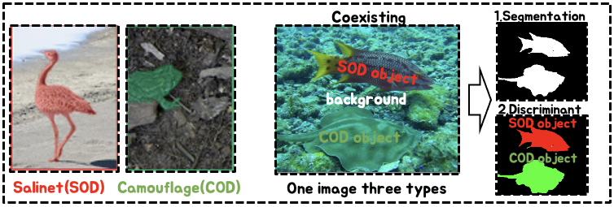
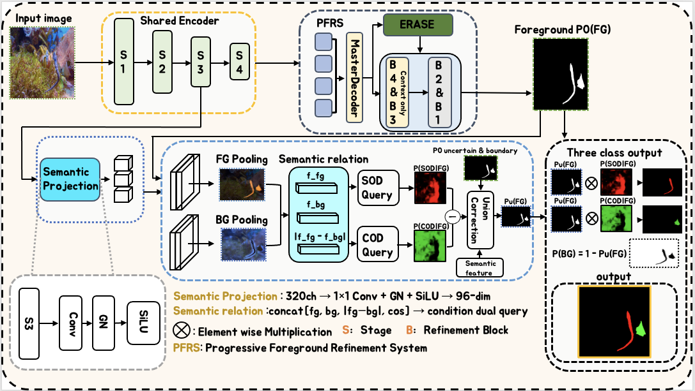
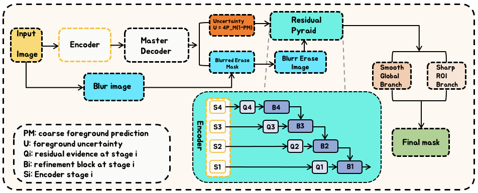
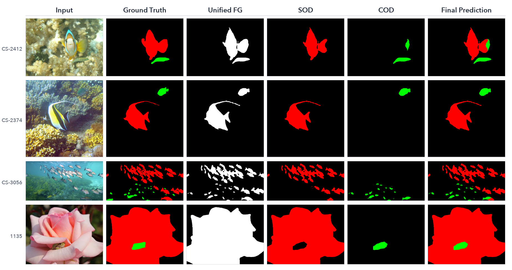

# SegDis: Segment First, Then Discriminate

Official implementation of **SegDis**, a unified model for salient object detection (SOD) and camouflaged object detection (COD). SegDis first discovers a type-agnostic foreground and then assigns SOD/COD labels inside that foreground at pixel level. This formulation supports images in which salient and camouflaged objects coexist.



## Method

SegDis contains two stages:

1. **Progressive Foreground Refinement System (PFRS).** A PVT-v2-B2 encoder, Master Decoder, erase evidence, residual pyramid, and four refinement blocks produce a unified foreground probability.
2. **Foreground type allocation.** Foreground/background pooled semantics condition two queries. The queries estimate `P(SOD | FG)` and `P(COD | FG)`, followed by uncertainty-boundary correction and foreground-constrained probability composition.

The final probabilities are factorized as

```text
P(BG)  = 1 - P(FG)
P(SOD) = P(FG) * P(SOD | FG)
P(COD) = P(FG) * P(COD | FG)
```



<p align="center">
  
</p>

The Master Decoder used to initialize the progressive refinement path is illustrated in [`assets/master_decoder.png`](assets/master_decoder.png).

## Results

USC12K validation results at `352 x 352` input resolution:

| Method | FG-mIoU | mIoU | IoU-S | IoU-C | CSCS (lower is better) |
|---|---:|---:|---:|---:|---:|
| USCNet | 68.455 | 78.030 | - | - | 7.490 |
| **SegDis** | **74.325** | **82.258** | **82.530** | **66.121** | **3.959** |

On mixed Scene-C images, SegDis obtains `82.541` IoU-S and `62.959` IoU-C, improving over USCNet by `7.741` and `17.229` percentage points, respectively.



## Installation

The reported experiments used Windows, Python 3.10.20, PyTorch 2.5.1, CUDA 12.1, torchvision 0.20.1, timm 1.0.28, NumPy 2.0.1, and Pillow 11.1.0.

```bash
conda env create -f environment.yml
conda activate segdis
```

Alternatively, install `requirements.txt` in an existing CUDA-enabled environment. Match the PyTorch wheel to the CUDA runtime on your machine.

## Data

Download USC12K using the instructions in the [USCNet repository](https://github.com/ssecv/USCNet). The expected layout is:

```text
VOC-USC12K/
├── JPEGImages/
├── SegmentationClass/
└── ImageSets/
    └── Segmentation/
        ├── train.txt
        ├── val.txt
        ├── Scene-A.txt
        ├── Scene-B.txt
        ├── Scene-C.txt
        └── Scene-D.txt
```

Labels use `0 = background`, `1 = SOD`, and `2 = COD`. Palette masks with black, red, and green class colors are converted automatically.

Download an ImageNet-1K pretrained PVT-v2-B2 checkpoint and provide its path through `--backbone_checkpoint`. Dataset files, pretrained weights, trained checkpoints, and predictions are intentionally excluded from Git.

## Training

Train the complete SegDis model from the PVT-v2-B2 initialization:

```bash
python -u train.py \
  --usc_root /path/to/VOC-USC12K \
  --backbone_checkpoint /path/to/pvt_v2_b2.pth \
  --output ./outputs/segdis \
  --epochs 50 \
  --batch_size 8 \
  --base_lr 1e-4 \
  --image_size 352 \
  --type_weight 0.5 \
  --calibration_weight 0.5 \
  --workers 4 \
  --seed 42 \
  --gpu 0
```

On Windows, the equivalent parameterized launcher is:

```powershell
.\scripts\train_segdis.ps1 `
  -UscRoot "C:\path\to\VOC-USC12K" `
  -BackboneCheckpoint "C:\path\to\pvt_v2_b2.pth"
```

Training is end to end. `best.pth` is selected by the lowest epoch-average training objective, matching the reported protocol; `latest.pth` also stores optimizer and scheduler state for `--resume`.

## Evaluation

Evaluate the complete validation set:

```bash
python -u evaluate.py \
  --usc_root /path/to/VOC-USC12K \
  --checkpoint ./outputs/segdis/best.pth \
  --split val \
  --output ./results/segdis/val.json \
  --gpu 0
```

The evaluator implements the main-table USCNet protocol exactly: the image is bilinearly resized to `352x352`, the GT label is nearest-neighbor resized to `352x352`, and the three-class prediction is evaluated directly at that resolution (without restoration to original image size). It reports the confusion matrix, pixel accuracy, IoU-BG/IoU-S/IoU-C, FG-mIoU, mIoU, mAcc, and the USCNet-compatible Camouflage-Saliency Confusion Score (CSCS). It does not require a separate USCNet checkout or OpenCV installation. The PowerShell launcher evaluates `Scene-A` through `Scene-D` and `val`:

```powershell
.\scripts\evaluate_usc12k.ps1 `
  -UscRoot "C:\path\to\VOC-USC12K" `
  -Checkpoint ".\outputs\segdis\best.pth"
```

## Inference

Export class-index PNG files at the original image resolution:

```bash
python -u infer.py \
  --usc_root /path/to/VOC-USC12K \
  --checkpoint ./outputs/segdis/best.pth \
  --split Scene-C \
  --output ./predictions/segdis/Scene-C \
  --format label \
  --gpu 0
```

`--format` accepts `label`, `color`, `separate`, or `all`. Color predictions use red for SOD and green for COD. The Windows launcher runs all four scenes:

```powershell
.\scripts\infer_usc12k.ps1 `
  -UscRoot "C:\path\to\VOC-USC12K" `
  -Checkpoint ".\outputs\segdis\best.pth" `
  -Format all
```

## Ablation Study

The exact B0--B4 ablation implementations, objectives, and launcher are maintained separately in the [`paper-ablation`](https://github.com/LUODN718/SegDis/tree/paper-ablation) branch. Keeping them outside `main` prevents experimental switches from obscuring the canonical SegDis pipeline.

## Repository Layout

```text
assets/                         Paper figures
models/frequency_adaptive_refinement_net.py
                                PFRS implementation
models/foreground_type_allocation.py
                                Foreground type allocation
dataset_usc12k.py               USC12K loader and label conversion
train.py                        Complete SegDis training entry point
infer.py                        Original-resolution prediction export
evaluate.py                     Self-contained USC12K evaluation
scripts/                        Reproducible Windows launchers
```

## Citation

Citation information and pretrained checkpoints will be added with the public paper release.

## Acknowledgements

The USC12K data organization and the definitions of mIoU and CSCS follow [USCNet](https://github.com/ssecv/USCNet). The encoder is initialized from an ImageNet-pretrained [PVT-v2](https://github.com/whai362/PVT) checkpoint.
