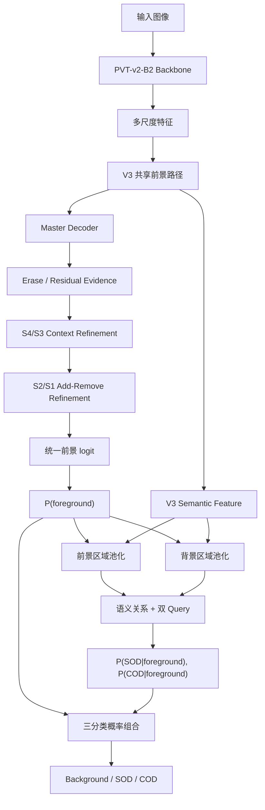

# JointDiff

JointDiff 是一个联合显著目标检测（SOD）与伪装目标检测（COD）的像素级分割模型。当前 GitHub 版本以你原来的 V3 为前景发现主干，在统一前景 mask 后增加 SOD/COD 类型分配模块，用于回答：

> 这里是不是前景？如果是，它属于 SOD 还是 COD？

## 当前模型

当前模型为 `V3ForegroundTypeAllocationNet`，核心结构如下：

当前 GitHub 默认分支：`feature/v3-foreground-type-allocation`



V3 的共享路径仍负责发现所有前景；新增的 allocation head 只负责在前景内部进行类型分配。模型不使用整图 task classifier，因此一张图中可以同时存在 SOD 与 COD（USC12K Scene-C）。

## 与原始 V3 的区别

| 项目 | 原始 V3 | 当前模型 |
|---|---|---|
| 主干 | PVT-v2-B2 + V3 | 相同 |
| 前景路径 | Master、Erase、Residual、S4/S3、S2/S1 refinement | 保留 |
| 输出 | `P(foreground)` | `P(foreground)` + SOD/COD 类型分配 |
| 类型判断 | 无 | 语义特征 + foreground/background pooling + 双 query |
| 混合场景 | 只能输出统一前景 | 可逐像素区分 SOD 与 COD |
| 训练标签 | 二值前景 | `0=background, 1=SOD, 2=COD` |
| 训练损失 | 前景结构损失 | 前景结构损失 + 类型交叉熵 + 三分类校准损失 |

当前模型不是重新替换 V3，而是把 V3 的强前景能力作为第一阶段，再学习前景类型分配。

## 概率定义

模型预测：

```text
P(foreground)
P(SOD | foreground)
P(COD | foreground)
```

最终三分类概率为：

```text
P(background) = 1 - P(foreground)
P(SOD)        = P(foreground) × P(SOD | foreground)
P(COD)        = P(foreground) × P(COD | foreground)
```

这种 factorized 形式保证 SOD/COD 预测受统一前景支持约束，不会完全脱离 V3 mask 独立产生前景。

## 训练目标

当前训练入口为 `train_v3_foreground_type.py`。默认目标函数：

```text
L = L_foreground + 0.5 × L_type + 0.5 × L_calibration
```

- `L_foreground`：V3 union mask 的 `structure_loss`；
- `L_type`：有效前景像素上的 SOD/COD 类型交叉熵；
- `L_calibration`：Background/SOD/COD 三分类负对数似然。

普通 SOD 数据的前景标为 1，普通 COD 数据的前景标为 2；USC12K 直接使用像素级三分类标签。训练默认从 ImageNet-1K 预训练的 PVT-v2-B2 开始，并端到端优化全部参数。

## USC12K 场景

```text
Scene-A：SOD-only
Scene-B：COD-only
Scene-C：SOD 与 COD 可同时出现
Scene-D：background-only
```

Scene-C 是区分模型是否真正学会 SOD/COD 分配的关键场景；推理时不输入 scene name 或 task flag。

## USC12K-only 训练

```bash
python -u train_v3_foreground_type.py \
  --usc_root /path/to/VOC-USC12K \
  --backbone_checkpoint /path/to/pvt_v2_b2.pth \
  --output ./output_v3_foreground_type_usc_only \
  --epochs 50 \
  --batch_size 8 \
  --base_lr 1e-4 \
  --workers 4 \
  --type_weight 0.5 \
  --calibration_weight 0.5 \
  --seed 42 \
  --gpu 0
```

## USC12K 352×352 消融实验

消融分支使用同一个训练入口，通过 `--ablation` 切换配置，避免不同脚本造成协议差异。所有实验固定 USC12K-only、352×352、PVT-v2-B2、seed=42；建议每个配置使用独立的 `--output` 目录。

| 编号 | 配置 | 验证内容 |
|---|---|---|
| A0 | 原始 V3 union-only | 纯前景分割基线 |
| A1 | V3 + 基础 type allocation，无 pooling/correction/calibration | 类型分配头本身 |
| A2 | A1 + foreground/background pooling + dynamic query | 池化与上下文 query |
| A3 | A2 + uncertainty/boundary correction | correction 模块 |
| A4 | A3 + type loss | 显式类型监督 |
| A5 | A4 + calibration loss | 完整模型与三分类校准 |

运行示例：

```bash
python -u train_v3_foreground_type.py \
  --usc_root /path/to/VOC-USC12K \
  --backbone_checkpoint /path/to/pvt_v2_b2.pth \
  --output ./ablation_A2_352 \
  --ablation A2 \
  --image_size 352 \
  --epochs 50 --batch_size 8 --base_lr 1e-4 \
  --type_weight 0.5 --calibration_weight 0.5 \
  --seed 42 --gpu 0
```

为了让 A1/A2 的类型分配头获得可学习信号，训练实现从 A1 开始启用 `L_type`；A3 验证 correction 的结构增益，A4 显式固定加入类型损失，A5 再加入 calibration。每个 checkpoint 会保存 `ablation` 和 `image_size` 元数据。

混合 SOD/COD 数据训练时，同时提供 `--sod_path` 和 `--cod_path`；USC12K 作为可选的像素标签数据源加入。

## 推理与评估

普通 SOD/COD 数据集推理：

```bash
python -u infer_v3_foreground_type.py \
  --path /path/to/TestDataset/CAMO \
  --checkpoint ./output_v3_foreground_type/best.pth \
  --output ./results_v3_foreground_type/CAMO \
  --device cuda \
  --gpu 0
```

USC12K 三分类协议评估：

```bash
python -u eval_jointdiff_uscnet_protocol.py \
  --usc_root /path/to/VOC-USC12K \
  --checkpoint ./output_v3_foreground_type/best.pth \
  --backbone_checkpoint /path/to/pvt_v2_b2.pth \
  --split val.txt \
  --output ./usc12k_metrics.json \
  --gpu 0
```

评估时区分两类指标：

- 常规 SOD/COD：S-measure、F-measure、E-measure、MAE；
- USC12K 三分类：`IoU-S`、`IoU-C`、`FG-mIoU`、`mIoU`、`CSCS` 以及混淆矩阵。

## 代码结构

```text
models/frequency_adaptive_refinement_net.py  V3 主干与 refinement
models/foreground_type_allocation.py         前景类型分配模型
dataset_semantic.py                          SOD/COD/USC12K 统一数据集
train_v3_foreground_type.py                  训练入口
infer_v3_foreground_type.py                  普通数据集推理
eval_jointdiff_uscnet_protocol.py            USC12K 三分类协议
eval_v3_foreground_type_usc.py               USC12K 前景与类型评估
```

## 研究定位

原始 V3 主要学习 objectness 和 figure-ground separation，擅长找出“可分割的前景”。当前模型进一步利用语义上下文，把前景分解为 SOD 与 COD，目标是减少联合模型在 USC12K 混合场景中的任务混淆，同时尽量保留 V3 的统一前景能力。

## 环境

```bash
pip install -r requirements.txt
```

训练权重和生成结果默认由 Git 忽略，不纳入版本库。
