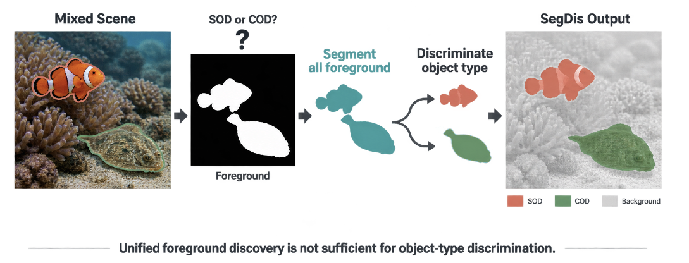
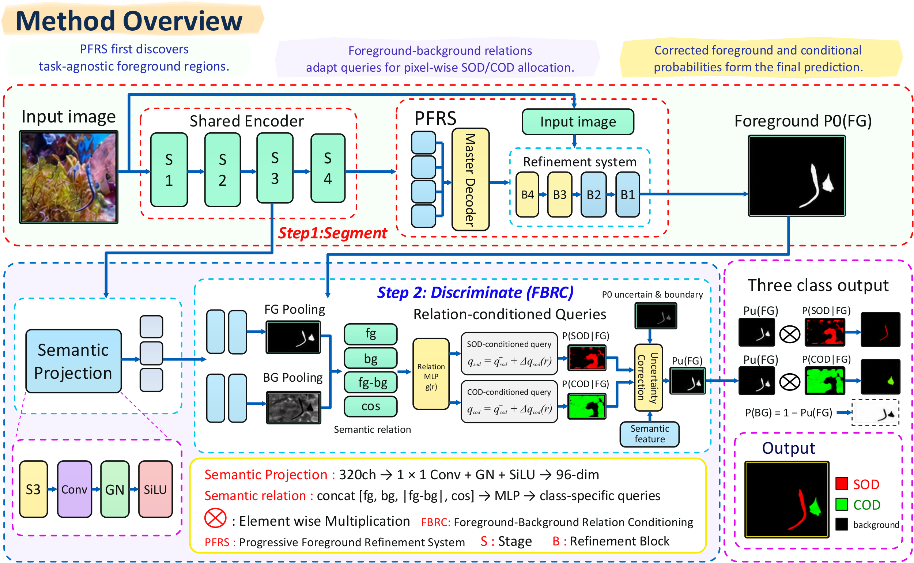
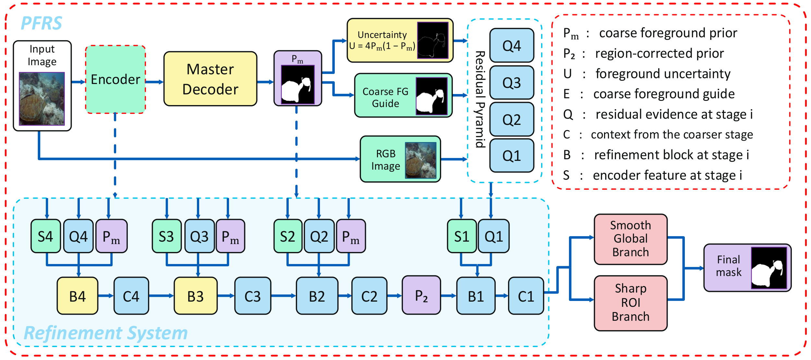
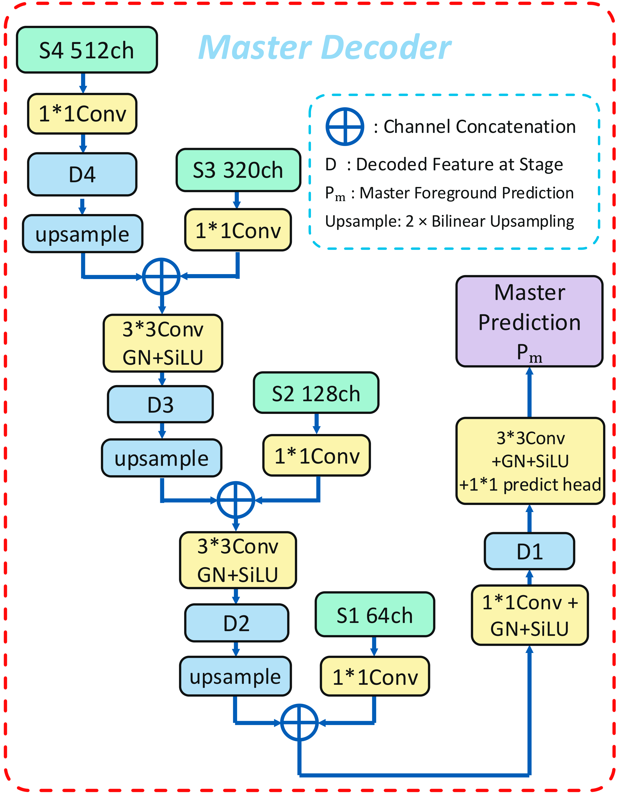
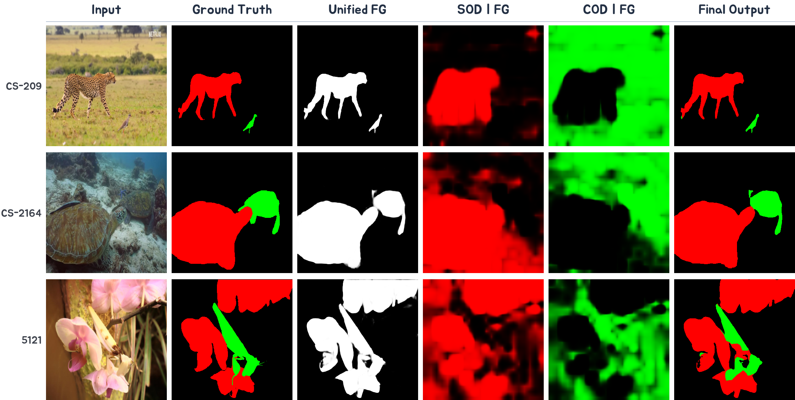
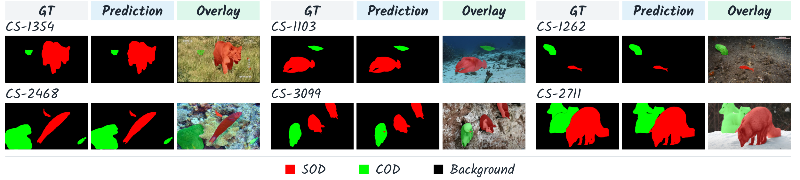

<h1 align="center">SegDis: Segment First, Then Discriminate</h1>
<h3 align="center">Unified Salient and Camouflaged Object Detection</h3>

<p align="center">
  <a href="#quick-start">Quick Start</a> ·
  <a href="#framework">Framework</a> ·
  <a href="#results-on-usc12k">Results</a> ·
  <a href="#training">Training</a> ·
  <a href="#evaluation">Evaluation</a> ·
  <a href="#checkpoints-and-reproducibility">Checkpoints</a>
</p>

<p align="center">
  
</p>

Salient object detection (SOD) and camouflaged object detection (COD) both
require foreground discovery, but a shared binary foreground mask cannot tell
the two object types apart when they coexist. **SegDis** explicitly separates
these decisions: it first discovers a type-agnostic foreground and then assigns
SOD/COD semantics to foreground pixels. No task identifier or scene label is
required at inference time.

## Highlights

- **Segment first:** a Progressive Foreground Refinement System (PFRS) produces
  a reliable unified foreground probability.
- **Then discriminate:** foreground/background semantics condition two
  class-specific queries for pixel-wise SOD/COD allocation.
- **Two classes inside foreground:** the type head predicts only
  `P(SOD | FG)` and `P(COD | FG)`; background is introduced by probability
  composition, not by a second foreground segmentation head.
- **Mixed-scene parsing:** SegDis directly predicts background, SOD, and COD in
  USC12K scenes where salient and camouflaged objects coexist.

This branch releases **SegDis-RGB with PVT-v2-B2**: 28.80M total parameters,
`352 x 352` input, and a complete training, inference, and evaluation pipeline.

## Quick Start

### 1. Install

```bash
git clone https://github.com/LUODN718/SegDis.git
cd SegDis
conda env create -f environment.yml
conda activate segdis
```

The supplied Conda environment targets NVIDIA CUDA 12.1. The model-based
training, inference, and evaluation entry points require CUDA; saved-prediction
evaluation also runs on CPU, including macOS.

### 2. Download the checkpoint

```bash
python scripts/download_checkpoint.py --use_git_credentials
```

For the current private repository, this uses your configured Git credential
helper. You need repository access. Alternatively, download the asset from the
[RGB release](https://github.com/LUODN718/SegDis/releases/tag/rgb-v1-20261026)
or use an existing `GITHUB_TOKEN` / `GH_TOKEN` environment variable with
`python scripts/download_checkpoint.py`. Do not put tokens in source files.
The downloader verifies the asset and saves it to
`checkpoints/segdis_rgb_pvtb2_352.pth`.

### 3. Export predictions

Prepare [USC12K](#data), replace the dataset path, and run:

```bash
python infer.py \
  --usc_root /path/to/VOC-USC12K \
  --checkpoint checkpoints/segdis_rgb_pvtb2_352.pth \
  --split Scene-C \
  --output predictions/segdis/Scene-C \
  --format color \
  --gpu 0
```

This exports `352 x 352` RGB PNGs: **red = SOD**, **green = COD**, and
**black = background**. For a full validation run, use `--split val` with
the [evaluation command](#evaluation).

## Framework

<p align="center">
  
</p>

The final probabilities are factorized as follows. Here `P(FG)` is the
foreground probability **after** FBRC's bounded correction:

```text
P(BG)  = 1 - P(FG)
P(SOD) = P(FG) * P(SOD | FG)
P(COD) = P(FG) * P(COD | FG)
```

The two conditional type probabilities sum to one. Their unmasked maps express
relative SOD/COD preference across the image; they are not another
foreground/background segmentation. Foreground support supplies the background
class and constrains the final three-class prediction.

### Progressive Foreground Refinement System

<p align="center">
  
  
</p>

PFRS combines a PVT-v2 encoder, a Master Decoder, RGB residual evidence,
progressive region refinement, and global/ROI boundary correction. The residual
encoder receives five channels, `[normalized original RGB, E, U]`:

```text
E = Blur(P_M^2)          coarse foreground guide
U = 4 * P_M * (1 - P_M)  foreground uncertainty
```

`P_M` is the Master Decoder's coarse foreground probability. The RGB channels
remain unchanged after normalization; `E` and `U` are concatenated as guidance,
not multiplied into the image to erase foreground regions.
The resulting foreground probability provides the spatial support for type
allocation.

### Foreground–Background Relation Conditioning (FBRC)

Features are softly pooled with foreground and background probabilities. Their
relation conditions two independently adapted SOD/COD queries, which match a
local semantic feature map at every position. A bounded uncertainty-boundary
correction updates foreground confidence before probability composition.

## Results on USC12K

SegDis results below were recomputed from 3,600 raw three-class predictions
using the public USCNet evaluation rules at `352 x 352`, without Scene-A/B
remapping. USCNet values are literature results, not a local reproduction.

All values below are percentages; higher is better except for CSCS.

| Method | FG-mIoU ↑ | mIoU ↑ | mAcc ↑ | IoU-S ↑ | IoU-C ↑ | CSCS ↓ |
|---|---:|---:|---:|---:|---:|---:|
| USCNet | 68.46 | 78.03 | **87.92** | 75.57 | 61.34 | 7.49 |
| **SegDis-RGB (PVT-v2-B2)** | **68.983** | **78.351** | 85.945 | **75.663** | **62.304** | **5.752** |

The RGB checkpoint contains **28,803,590 parameters** and was selected at
epoch 50 by minimum mean training loss, without validation-based selection.
USCNet scores are reported in the
[original paper](https://openaccess.thecvf.com/content/ICCV2025/papers/Zhou_Rethinking_Detecting_Salient_and_Camouflaged_Objects_in_Unconstrained_Scenes_ICCV_2025_paper.pdf).
Small differences are not a claim of statistical significance.

| Scene | Ground-truth foreground | IoU-BG ↑ | IoU-S ↑ | IoU-C ↑ | CSCS ↓ |
|---|---|---:|---:|---:|---:|
| A | SOD only | 96.947 | 83.139 | 0.000 | 45.589 |
| B | COD only | 95.402 | 0.000 | 69.788 | 18.579 |
| C | SOD and COD | 95.804 | 71.612 | 51.487 | 11.822 |
| D | Background only | 99.835 | 0.000 | 0.000 | 0.000 |

Absent-type IoUs are zero when that type is falsely predicted. Scene-D has
background false positives despite CSCS=0. Overall scores use the sum of all
four scene confusion matrices, not the average of scene scores. Exact results
and confusion counts are in
[the USC12K result record](benchmarks/usc12k_rgb_352.json).
CSCS uses predicted-class denominators, so it should be interpreted together
with class IoUs and foreground coverage, not as a direct foreground swap rate.

<details>
<summary>Earlier results and evaluation correction</summary>

Historical erased-input results (68.791 FG-mIoU, 78.231 mIoU, 5.945 CSCS)
belong to a different checkpoint and are not the RGB release above.

**Evaluation correction:** earlier reported `71.820 FG-mIoU / 80.250 mIoU /
3.275 CSCS` used scene-aware remapping: all foreground became SOD in Scene-A
and COD in Scene-B. Those values are not comparable to USCNet's raw three-class
evaluation and are superseded by the table above. No scene remapping is
supported by the canonical evaluators. Scene-C/D predictions are unaffected.

</details>

## Qualitative Results

The framework, PFRS, and Master Decoder diagrams above are exported from the
current manuscript. The teaser and qualitative figures retain earlier
checkpoint examples: they illustrate the prediction pipeline, not new
benchmark evidence for the released RGB checkpoint.

<p align="center">
  
</p>

The `SOD | FG` and `COD | FG` columns contain the two conditional type
probabilities and no background channel. The last column is produced only after
combining these responses with the unified foreground probability.

<p align="center">
  
</p>

Red denotes SOD, green denotes COD, and black denotes background.

## Installation

The reported experiments used Python 3.10.20, PyTorch 2.5.1, CUDA 12.1,
torchvision 0.20.1, timm 1.0.28, NumPy 2.0.1, and Pillow 11.1.0.

See [Quick Start](#quick-start) for the Conda setup. Alternatively, install
`requirements.txt` in an existing CUDA environment:

```bash
python -m pip install -r requirements.txt
```

Match the PyTorch wheel to the CUDA runtime on your machine.

## Data

Download USC12K following the instructions in the
[USCNet repository](https://github.com/ssecv/USCNet). The expected layout is:

```text
VOC-USC12K/
├── JPEGImages/
├── SegmentationClass/
└── ImageSets/
    └── Segmentation/
        ├── train.txt
        ├── val.txt
        ├── Scene-A.txt
        ├── Scene-B.txt
        ├── Scene-C.txt
        └── Scene-D.txt
```

Labels use `0 = background`, `1 = SOD`, and `2 = COD`; the loader also handles
the black/red/green label colors. The release uses 8,400 training images and
3,600 evaluation images, with 900 images per evaluation scene. Dataset files
are not bundled with this repository.

To train from scratch with ImageNet initialization, download an
ImageNet-1K pretrained PVT-v2-B2 checkpoint and pass its path through
`--backbone_checkpoint`. This backbone file is **not** the complete SegDis
checkpoint used for inference and evaluation.

## Training

```bash
python -u train.py \
  --usc_root /path/to/VOC-USC12K \
  --backbone_checkpoint /path/to/pvt_v2_b2.pth \
  --backbone_name pvt_v2_b2 \
  --output ./outputs/segdis \
  --epochs 50 \
  --batch_size 8 \
  --base_lr 1e-4 \
  --image_size 352 \
  --type_weight 0.5 \
  --calibration_weight 0.5 \
  --workers 4 \
  --seed 42 \
  --gpu 0
```

Training is end to end; PFRS is not pretrained separately. The objective is

```text
L = L_foreground + 0.5 * L_type + 0.5 * L_composed
```

where the type loss is evaluated on annotated foreground pixels and the
composed loss supervises the final three-class probabilities.

The released protocol uses AdamW, weight decay `5e-4`, cosine learning-rate
decay, gradient clipping at `5.0`, and seed `42`; see
[the training record](benchmarks/training_protocol.json).
`best.pth` minimizes the epoch-average training objective. `latest.pth` also
stores optimizer, scheduler, and RNG state for `--resume`. The downloadable
inference checkpoint omits those states and is not an exact-resume checkpoint.

## Evaluation

```bash
python -u evaluate.py \
  --usc_root /path/to/VOC-USC12K \
  --checkpoint ./outputs/segdis/best.pth \
  --split val \
  --output ./results/segdis/val.json \
  --gpu 0
```

The output JSON contains the confusion matrix and `IoU-BG`, `IoU-S`, `IoU-C`,
`FG-mIoU`, `mIoU`, `mAcc`, `pixelAcc`, and `CSCS`. The protocol is:

1. Bilinear resize input images to `352 x 352` and apply ImageNet normalization.
2. Decode GT into `0=background, 1=SOD, 2=COD`, then resize by nearest neighbor.
3. Take three-class argmax at 352. Do not restore the original resolution.
4. Preserve predicted types in **all** scenes, including Scene-A/B. Predicting
   COD in Scene-A or SOD in Scene-B is an error; scene identity never corrects it.
5. Sum confusion matrices (GT rows, prediction columns) before computing metrics.
   Do not average scene scores to obtain the overall result.
6. Apply the same formulas to all splits. Undefined divisions produce JSON
   `null`, not an artificial zero. Absent GT classes can have IoU zero when
   falsely predicted. Per-scene means therefore need careful interpretation.

CSCS is `0.5 * (CM[1,2]/CM[:,2].sum() + CM[2,1]/CM[:,1].sum())`;
the reported percentage is this value multiplied by 100. The implementation
computes the same formula on every split and does not suppress Scene-A/B
scores. A zero score on Scene-D does not imply no background false positives.
Reference: [USCNet test.py](https://github.com/ssecv/USCNet/blob/579934129ea84c9ab7a5c50cc8f58841ee3c330e/test.py)
and its `metrics/miou.py`. We use float64 accumulation for exact pixel counts;
the official float32 implementation can differ by negligible rounding. FG-mIoU
is the mean of SOD and COD IoU, added to the official reported metrics.

### Evaluate saved predictions (CPU, including macOS)

```bash
python evaluate_predictions.py \
  --usc_root /path/to/VOC-USC12K \
  --pred_root ./predictions/segdis \
  --format color \
  --split val \
  --output ./results/segdis/saved_val.json
```

This produces overall and Scene-A/B/C/D results using the same metric class as
`evaluate.py`. Predictions may be in `pred_root/Scene-X/sample_id.png` or a flat
directory; ambiguous duplicates are rejected. `--format color` requires exact
black/red/green RGB or palette PNGs; `--format label` requires single-channel
0/1/2 PNGs. Binary 0/255 masks, unknown colors, missing files and non-352 images
are rejected. No thresholding, resizing of predictions, or scene remapping occurs.
Previously remapped/binary-only exports cannot recover lost type predictions;
export raw predictions again. Legacy `_color.png` files must be renamed to
`sample_id.png` in a dedicated directory, not mixed with other formats.

## Inference

```bash
python -u infer.py \
  --usc_root /path/to/VOC-USC12K \
  --checkpoint ./outputs/segdis/best.pth \
  --split Scene-C \
  --output ./predictions/segdis/Scene-C \
  --format color \
  --gpu 0
```

The default `--format color` saves one RGB `sample_id.png` per input. `label`
saves class-index PNGs with the same names; use separate directories for formats.
`separate` and `all` are visualization-only exports, not the canonical evaluation
input (`all` also writes suffixed files). `--format` accepts all four modes. Use
`--original_size` only when original-resolution exports are needed; do not use
it for the fixed-resolution benchmark protocol.

## Repository Layout

```text
assets/                              Figures referenced in this README
models/
  factory.py                         Model construction and checkpoint validation
  foreground_type_allocation.py      Complete SegDis / FBRC
  frequency_adaptive_refinement_net.py  PFRS and its required refinement blocks
  master_residual_net.py             Shared encoder, Master Decoder, residual blocks
utils/                               Foreground loss and canonical evaluation
tests/                               Model and evaluation regression tests
scripts/                             Checkpoint tools and Windows launchers
benchmarks/                          Result counts, training protocol, release records
config.py                            Model configuration
dataset_usc12k.py                     Dataset loading and label conversion
train.py                             End-to-end training
infer.py                             Prediction export
evaluate.py                          Fixed USCNet-protocol evaluation
evaluate_predictions.py              Saved-PNG evaluation (CPU / macOS supported)
export_intermediates.py               Intermediate visualization export
requirements.txt                     Python dependencies
environment.yml                      Conda environment
```

`main` contains the complete model and its reproducible pipeline, not historical
experimental networks or ablation launchers. The legacy `v3` module names and
checkpoint metadata are retained for compatibility with released weights;
`B4` in checkpoint metadata identifies the complete configuration, **not** a
PVT-v2-B4 backbone. The default encoder is PVT-v2-B2.

Dataset files, checkpoints, predictions, logs, and local experiment outputs belong outside
version control and are excluded by `.gitignore`.

## Checkpoints and Reproducibility

| Item | Reference |
|---|---|
| Complete RGB weights | [Release `rgb-v1-20261026`](https://github.com/LUODN718/SegDis/releases/tag/rgb-v1-20261026) |
| Asset and integrity information | [Release manifest](benchmarks/rgb_release.json) |
| USC12K counts and metrics | [Raw three-class results](benchmarks/usc12k_rgb_352.json) |
| Binary foreground measurements | [PFRS / corrected foreground results](benchmarks/foreground_rgb_352.json) |
| Training configuration | [Training protocol](benchmarks/training_protocol.json) |
| Implementation equivalence check | [Verification record](benchmarks/release_verification.json) |

Follow [Quick Start](#quick-start) to download the weights. Pass the complete
checkpoint to `--checkpoint` in inference, evaluation, and intermediate export.
All selected model tensors are preserved exactly; dataset files and ImageNet
backbone weights are not bundled. Credentials are not saved in the repository
or forwarded to redirected asset hosts by the downloader.

The loader requires `residual_input_mode=rgb` and rejects historical erased
checkpoints: both modes have identical tensor shapes but different behavior.
Source and published asset hashes are in
[the release manifest](benchmarks/rgb_release.json).

The release implementation was checked against the frozen RGB experiment
using one real 352x352 image per USC12K scene. Probabilities, foreground logits,
type logits and residual inputs match within 1e-6; all four final label maps
match stored experiment predictions exactly. This checks implementation
equivalence; it is not a fresh full-dataset benchmark.

```bash
python -m unittest discover -s tests -v
```

These model and evaluation regression tests run on CPU without downloading
pretrained weights. They check implementation behavior, not benchmark accuracy.

## Citation

BibTeX will be added when a public paper identifier is available.

## Acknowledgements

The USC12K data organization and the definitions of mIoU and CSCS follow
[USCNet](https://github.com/ssecv/USCNet). The encoder is initialized from an
ImageNet-pretrained [PVT-v2](https://github.com/whai362/PVT) checkpoint.
