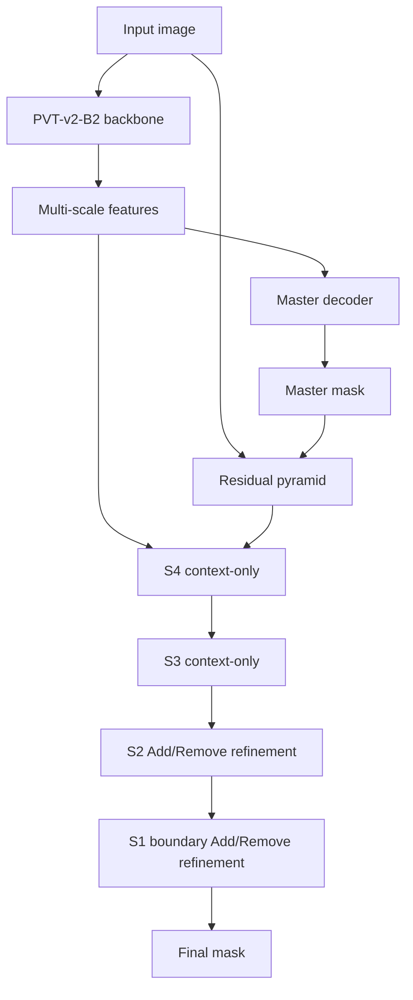

# JointSCOD

## V3 Foreground-Type Allocation (JointDiff)

This repository also contains an end-to-end extension of the verified V3
baseline. It preserves V3's unified foreground mask and adds a pixel-level
SOD/COD allocator for USC12K mixed scenes. The allocator predicts
`P(type | foreground)` and produces `union`, `sod`, `cod`, and three-class
probabilities. It is not a whole-image task classifier.

```text
PVT-v2-B2 + V3 Master/Refinement -> P(union)
                              \-> foreground-conditioned SOD/COD allocator
                                  -> P(background), P(SOD), P(COD)
```

The semantic correction residual is zero-initialized and restricted by V3
uncertainty/boundary evidence. Therefore the new model starts exactly at the
V3 foreground behavior while allowing semantic evidence to learn a bounded
union-mask correction during the same end-to-end run.

Train all components together:

```bash
python train_v3_foreground_type.py \
  --sod_path /path/to/SOD/SOD-TrainDataset/DUTS-TR \
  --cod_path /path/to/COD/TrainDataset \
  --usc_root /path/to/USC12K \
  --backbone_checkpoint /path/to/pvt_v2_b2.pth \
  --output ./output_foreground_type \
  --epochs 50 --batch_size 8 --base_lr 1e-4 --seed 42 --gpu 0
```

Infer all three masks in one pass:

```bash
python infer_v3_foreground_type.py \
  --path /path/to/test/root \
  --checkpoint ./output_foreground_type/best.pth \
  --output ./results_foreground_type \
  --device cuda --gpu 0
```

`union` is the standard task-agnostic foreground output; `sod` and `cod` are
the pixel-level task-specific outputs for USC12K Scene-C analysis.

JointSCOD is the joint SOD/COD training repository built on the confirmed
MRFNet V3 baseline.

The `main` branch keeps the current canonical baseline only: one shared
foreground segmentation model, one prediction head, no task flag at inference,
and the new 50-epoch joint training strategy.

## Canonical Baseline

```text
Backbone: PVT-v2-B2
Model: FrequencyAdaptiveRefinementNet
Variant: v3_joint_shared
Ablation: no_gate_no_frequency_s4_s3_context
Training script: train_joint_direction.py
Experiment: baseline
Loss: structure_loss(final, GT)
Task flag at inference: not required
```

The structure follows the best V3 setting:

```text
PVT-v2-B2 Backbone
+ Master Decoder
+ Residual Pyramid
+ S4/S3 context-only refinement
+ S2/S1 Add/Remove refinement
+ no Gate
+ no Frequency branch
```



## Training Logic

The current baseline is task-agnostic joint learning:

- SOD and COD samples are mixed during training.
- The model is not told which task to output during inference.
- Only the final prediction is supervised by the standard structure loss.
- Master, residual, erase, and Add/Remove refinement are shared by both tasks.

This is the clean baseline used for later SOD/COD disambiguation experiments.
Older asymmetric, adapter, and self-routed strategies are not the recommended
main path anymore.

## Canonical Training Command

PowerShell example used for the confirmed baseline:

```powershell
$repo = "C:\Users\lixianfeng\Desktop\JointSCOD"
$py   = "C:\Users\lixianfeng\anaconda3\envs\JointSCOD\python.exe"
if (-not (Test-Path -LiteralPath $py)) { $py = "python" }

& $py -u "$repo\train_joint_direction.py" `
  --experiment baseline `
  --sod_path "$repo\SOD\SOD-TrainDataset\DUTS-TR" `
  --cod_path "$repo\COD\TrainDataset" `
  --backbone_checkpoint "$repo\pvt_v2_b2.pth" `
  --output "$repo\output_direction_baseline" `
  --batch_size 8 `
  --epochs 50 `
  --base_lr 1e-4 `
  --gpu 0 `
  --seed 42
```

Equivalent bash example:

```bash
python train_joint_direction.py \
  --experiment baseline \
  --sod_path /path/to/SOD/SOD-TrainDataset/DUTS-TR \
  --cod_path /path/to/COD/TrainDataset \
  --backbone_checkpoint /path/to/pvt_v2_b2.pth \
  --output ./output_direction_baseline \
  --batch_size 8 \
  --epochs 50 \
  --base_lr 1e-4 \
  --gpu 0 \
  --seed 42
```

## Inference

Use the shared V3 joint variant for both SOD and COD test sets:

```bash
python test.py \
  --variant v3_joint_shared \
  --path /path/to/TestDataset/CAMO \
  --checkpoint ./output_direction_baseline/best.pth \
  --output ./results_direction/baseline/COD/CAMO \
  --gpu 0
```

The checkpoint metadata should report:

```text
variant = v3_joint_shared
experiment = baseline
ablation = no_gate_no_frequency_s4_s3_context
```

## Direction Branch Experiment

This branch adds the target-context affinity attempt on top of the clean
baseline. The goal is to test whether a small foreground/background feature
pairing module can learn a continuous saliency-camouflage affinity instead of
only outputting every separable foreground region.

```text
Training mode: context_affinity
Inference variant: v3_joint_context_affinity
Extra loss: BCE(context_affinity_logit, task_id)
Default affinity weight: 0.05
```

```bash
python train_joint.py \
  --mode context_affinity \
  --sod_path /path/to/SOD/SOD-TrainDataset/DUTS-TR \
  --cod_path /path/to/COD/TrainDataset \
  --backbone_checkpoint /path/to/pvt_v2_b2.pth \
  --output ./output_context_affinity \
  --batch_size 8 \
  --epochs 50 \
  --base_lr 1e-4 \
  --affinity_loss_weight 0.05 \
  --gpu 0 \
  --seed 42
```

```bash
python test.py \
  --variant v3_joint_context_affinity \
  --path /path/to/TestDataset/CAMO \
  --checkpoint ./output_context_affinity/best.pth \
  --output ./results_context_affinity/COD/CAMO \
  --gpu 0
```

## Archived Loss Experiments

`train_joint_direction.py` also keeps several loss-level hypotheses for
controlled follow-up experiments. They are not the canonical baseline and are
archived under `archive/correction-aware-direction`.

| Experiment | Extra idea |
|---|---|
| `baseline` | final structure loss only |
| `signed_correction` | supervise Add/Remove direction from detached Master error |
| `master_protection` | protect reliable Master regions from unnecessary correction |
| `adaptive_correction` | dynamically weight correction loss by Master correction demand |
| `signed_protection` | signed correction + Master protection |
| `full` | signed correction + protection + adaptive weighting |

See `experiment_configs/direction_baseline.md` for the fixed baseline protocol
and `experiment_configs/archive_notes.md` for archived branch notes.

## Active Branches

```text
main
  canonical V3 joint baseline and new training protocol

direction
  target-context affinity attempt for SOD/COD semantic disambiguation
```

Old experiment branches are preserved as tags:

```text
archive/joint-component-ablation
archive/correction-aware-direction
```
