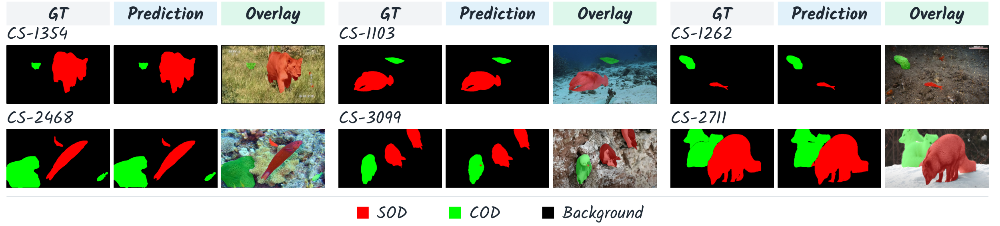

# Historical SegDis-RGB v1 records

These files describe the model before removal of five zero-input projection
branches and their fusion input channels. They **do not apply to the current
`segdis_rgb_v2` architecture**. They are retained for experiment provenance.

- `rgb_release.json`: historical checkpoint identity and hashes.
- `usc12k_rgb_352.json`: historical raw three-class results.
- `foreground_rgb_352.json`: historical binary foreground results.
- `training_protocol.json`: hyperparameters of the historical experiment.
- `release_verification.json`: equivalence check of the historical implementation.
- `source_cleanup_verification.json`: the earlier dead-source cleanup, which still
  retained zero-input projections. Its equivalence claim does not cover v2.

The matching source is preserved in Git commit
`436f7a3c7826a74d8c11d0d5465efd4ef0d31a5b` and its ancestors.
Do not use these checkpoint files to resume, evaluate, or report the current
model. Train and evaluate v2 separately before updating manuscript results.

## Historical qualitative examples

These manuscript examples belong to earlier experiments, not the current v2
architecture. Red denotes SOD, green COD, and black background.

